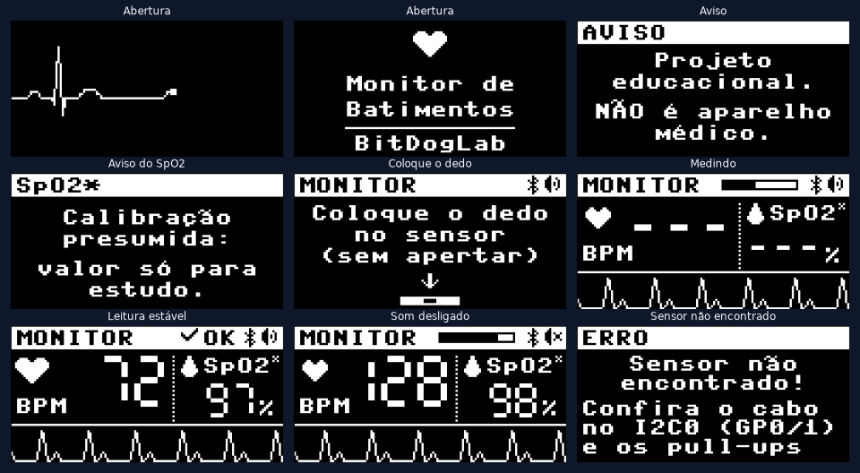
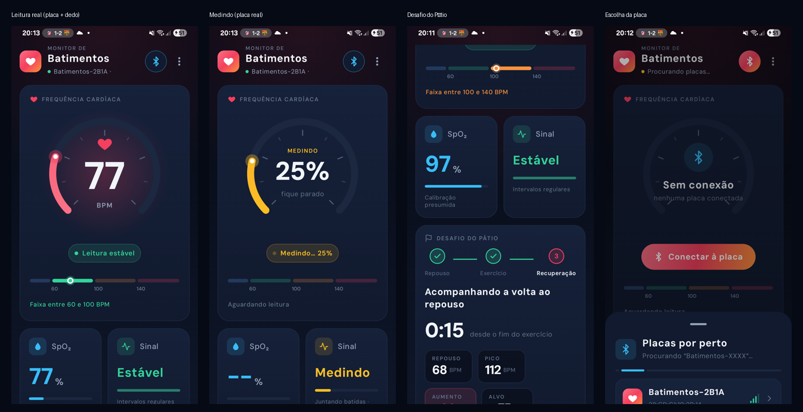

# PulseLab: Monitor de Batimentos

Projeto educacional de **frequência cardíaca (BPM)** e **oxigenação aproximada
(SpO₂)** com a placa **BitDogLab** (Raspberry Pi Pico W) e o sensor óptico
**MAX30102**, feito para ser demonstrado no pátio de uma escola técnica: um
voluntário mede os batimentos em repouso e depois de pular.

> ## ⚠️ Projeto educacional: NÃO é aparelho médico
> Os valores servem para estudar como funciona um oxímetro de pulso e não
> servem para nenhuma decisão de saúde. O SpO₂ usa uma **calibração presumida**.



## Os dois projetos

| Pasta | O que é | Tecnologia |
|---|---|---|
| [`monitor-batimentos/`](monitor-batimentos/) | Programa da placa: driver do sensor, filtros, detecção de batimentos, SpO₂, telas do OLED, coração na matriz de LEDs, bipe, **Desafio do Pátio** e envio por **Bluetooth**. Também tem a página `web/index.html`, um painel para o telão no Chrome/Edge | MicroPython |
| [`app-monitor-batimentos/`](app-monitor-batimentos/) | **App Android** que se conecta à placa por Bluetooth e mostra o painel: medidor do BPM, SpO₂, onda do pulso e o desafio | Kotlin + Jetpack Compose |

Cada pasta tem o próprio README, com instalação, uso, calibração e problemas
comuns.



## Como as partes conversam

```
 MAX30102 ──I2C──> BitDogLab (MicroPython) ──Bluetooth LE──> página web (Chrome/Edge)
   sensor          filtros, BPM, SpO₂,                   └──> app Android
                   OLED, matriz, buzzer
```

A placa envia dois tipos de pacote por BLE: **estado** (16 bytes: BPM, SpO₂,
situação da leitura, desafio) e **onda** (8 pontos por pacote). O formato está
descrito em [`monitor-batimentos/lib/painel_ble.py`](monitor-batimentos/lib/painel_ble.py)
e é o mesmo na página e no app.

## Começo rápido

1. **Placa:** grave o firmware MicroPython da Pico W, copie
   `monitor-batimentos/config.py.example` para `config.py` e envie a pasta para a
   placa pelo MicroPico (VS Code). Veja o
   [README da placa](monitor-batimentos/README.md).
2. **Painel no computador:** abra `monitor-batimentos/web/index.html` no Chrome ou
   Edge e clique em **Conectar à placa**. Para testar sem a placa, abra
   `web/index.html?demo`.
3. **App Android:** abra `app-monitor-batimentos` no Android Studio e clique em
   **Run**. Veja o [README do app](app-monitor-batimentos/README.md).

## Privacidade

Nenhum nome ou identificação é pedido ou guardado. As leituras ficam só na
memória e nada vai para a internet: a placa não usa Wi-Fi, a página não carrega
nada de fora e o app não tem permissão de internet.

## Créditos

- Driver do OLED SSD1306: [micropython-lib](https://github.com/micropython/micropython-lib) (MIT).
- Método da razão das razões do SpO₂: Maxim Integrated, projeto de referência MAXREFDES117.
- Fonte DM Sans (app): SIL Open Font License, em
  [`app-monitor-batimentos/docs/OFL-DMSans.txt`](app-monitor-batimentos/docs/OFL-DMSans.txt).
