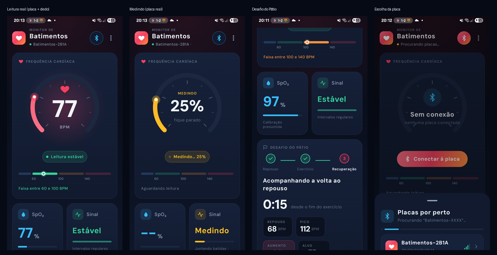

# Monitor de Batimentos: app Android

App Android (Kotlin + Jetpack Compose) que funciona como **painel** do projeto
[Monitor de Batimentos](../monitor-batimentos/). Ele se conecta por **Bluetooth Low
Energy** à placa BitDogLab e mostra o mesmo que a página `web/index.html`: BPM,
SpO2, coração que pulsa a cada batida, a onda do pulso e o Desafio do Pátio.

> ## ⚠️ Projeto educacional: NÃO é aparelho médico
> Os valores servem só para estudar como funciona um oxímetro de pulso. O SpO2
> usa uma **calibração presumida** (veja o README do projeto da placa).



*Fotos de tela de um Galaxy A05s (Android 15): leitura real com a placa e o dedo,
medição em andamento, o Desafio (modo demonstração) e a escolha da placa.*

---

## O que o app faz

- **Procura** as placas `Batimentos-XXXX` por perto e mostra uma lista com a
  força do sinal (barrinhas).
- **Conecta** e recebe as notificações BLE da placa, cerca de 10 por segundo.
  Se a conexão cair, tenta reconectar sozinho (5 tentativas).
- **Medidor circular** do BPM: um anel em degradê com marcas a cada 20 BPM e
  brilho que pulsa a cada batida. Enquanto mede, o anel vira uma **barra de
  progresso âmbar**.
- **Barra de faixas** segmentada (as mesmas 4 faixas do LED RGB da placa), com
  um marcador no BPM atual. É só uma faixa de valores, sem interpretação médica.
- Cartões de **SpO₂** (com a nota da calibração presumida) e de **Sinal**
  (sem dedo, medindo ou estável).
- **Onda do pulso** num "papel de monitor": grade quadriculada, área em degradê
  e o selo **AO VIVO**.
- **Desafio do Pátio** (botão B da placa) com etapas (Repouso → Exercício →
  Recuperação), cronômetro grande e o aumento do BPM em destaque.
- Mantém a **tela acesa** enquanto está conectado.
- **Modo demonstração** (menu ⋮): funciona sem a placa e mostra todas as telas,
  inclusive o desafio.
- Celular em pé: uma coluna. Celular deitado: duas colunas, com rolagem.
  Tablet: tudo numa tela só.
- Fonte **DM Sans** embutida (licença SIL Open Font License, em
  [`docs/OFL-DMSans.txt`](docs/OFL-DMSans.txt)).

---

## Requisitos

- Celular com **Android 8.0 ou mais novo** e **Bluetooth LE** (praticamente todos).
- **Android Studio** (versão recente) para compilar. O projeto usa Gradle 9.9,
  Android Gradle Plugin 9.5 (com o Kotlin embutido), Kotlin 2.4, Compose BOM
  2026.09 e compila com o SDK do Android 37. Roda do Android 8 em diante.
- A placa com o programa do `monitor-batimentos` e `BLE_ATIVO = True` no
  `config.py` dela.

---

## Compilar e instalar

### Pelo Android Studio (o jeito mais simples)

1. Abra o Android Studio → **Open** → escolha a pasta **`app-monitor-batimentos`**.
2. Espere o **Gradle Sync** terminar. Na primeira vez ele baixa as bibliotecas e
   leva alguns minutos.
3. No celular, ative a **Depuração USB**:
   - Configurações → **Sobre o telefone** → **Informações do software** → toque
     **7 vezes** em **Número de compilação** (no Samsung o caminho é esse; em
     outras marcas é parecido);
   - volte → **Opções do desenvolvedor** → ligue **Depuração USB**;
   - conecte o cabo e aceite a pergunta "Permitir depuração USB?".
4. Escolha o celular na barra de cima do Android Studio e clique em **Run ▶**.

### Gerar o APK (para instalar em outros celulares)

**Build → Build App Bundle(s) / APK(s) → Build APK(s)**. O arquivo fica em
`app/build/outputs/apk/debug/app-debug.apk`. Envie para o celular e abra para
instalar (o Android pede para permitir "instalar apps desconhecidos").

### Pelo terminal (sem abrir o Android Studio)

Use o Java que vem com o Android Studio e o `gradlew` do projeto:

```
set JAVA_HOME=C:\Program Files\Android\Android Studio\jbr
gradlew test assembleDebug
adb install -r app\build\outputs\apk\debug\app-debug.apk
```

(O `adb` fica em `%LOCALAPPDATA%\Android\Sdk\platform-tools`. Na primeira vez,
crie o arquivo `local.properties` com `sdk.dir=C:/Users/SEU_USUARIO/AppData/Local/Android/Sdk`;
o Android Studio cria esse arquivo sozinho.)

### Testes automáticos

Os testes conferem o decodificador dos pacotes Bluetooth com bytes montados
**exatamente** como a placa monta:

```
gradlew test
```

(ou, no Android Studio, clique com o botão direito em `app/src/test` → **Run Tests**).

---

## Como usar

1. Ligue a placa. No OLED, o ícone do Bluetooth fica **piscando** (esperando conexão).
2. No app, toque em **Conectar**.
   - Na primeira vez, o Android pede a permissão de **dispositivos próximos**
     (Bluetooth). Ela é necessária para achar a placa.
   - Se o Bluetooth estiver desligado, o app pede para ligar.
3. Escolha **Batimentos-XXXX** na lista. O ícone do Bluetooth no OLED fica **aceso**.
4. Coloque o dedo no sensor (só encostado, sem apertar).

**Modo demonstração:** menu **⋮ → Modo demonstração**. Ele simula a placa num
ciclo de 60 s: monitor, depois o desafio na recuperação e depois o resultado.
Bom para testar o app ou mostrar aos alunos sem a placa.

---

## Permissões (e por quê)

| Permissão | Quando | Para quê |
|---|---|---|
| `BLUETOOTH_SCAN` | Android 12+ | Procurar a placa. Marcada como `neverForLocation`: o app promete não usar a busca para localizar ninguém |
| `BLUETOOTH_CONNECT` | Android 12+ | Conectar e receber os dados |
| `ACCESS_FINE_LOCATION` | só Android 8 a 11 | Nessas versões, o Android exige a Localização para buscar aparelhos Bluetooth |

O app **não tem permissão de internet**: ele não consegue enviar nada para fora
do celular.

---

## Como o código está organizado

```
app/src/main/java/br/pulselab/batimentos/
├─ MainActivity.kt        início do app; permissões e ligar o Bluetooth
├─ MonitorViewModel.kt    estado da tela, onda (128 pontos) e modo demonstração
├─ ble/
│  ├─ Protocolo.kt        UUIDs e decodificação dos pacotes (Kotlin puro, testável)
│  └─ ConexaoBle.kt       busca, conexão GATT, notificações e reconexão
└─ ui/
   ├─ Tema.kt             cores, degradês e a fonte DM Sans
   ├─ Icones.kt           ícones desenhados a partir de caminhos SVG
   ├─ Graficos.kt         anel do BPM, barra de faixas, mini-barras e a onda
   ├─ Cartoes.kt          cartões, chips de status, desafio com etapas, rodapé
   └─ PainelTela.kt       montagem da tela (1 ou 2 colunas), lista de placas, "Sobre"
app/src/test/.../ProtocoloTest.kt   testes do decodificador
```

### O protocolo Bluetooth

É o mesmo da placa ([`lib/painel_ble.py`](../monitor-batimentos/lib/painel_ble.py))
e da página ([`web/index.html`](../monitor-batimentos/web/index.html)). **Se mudar
em um, mude nos três.**

| Característica | UUID | Conteúdo |
|---|---|---|
| Serviço | `448e804d-b3e1-4c80-89f5-91c53751f51a` | Agrupa as duas características abaixo |
| Estado (ler + notificar) | `114b64c2-3004-4c6f-8311-1dbaa117286e` | 16 bytes: situação, flags, BPM, SpO2, progresso, contador de batidas, desafio, sequência |
| Onda (notificar) | `ab2cad3c-87af-494c-9f9f-62b21297da07` | sequência, n e n pontos `int16` (8 por pacote) |

Detalhe de cada byte em [`Protocolo.kt`](app/src/main/java/br/pulselab/batimentos/ble/Protocolo.kt).

### Por que as operações Bluetooth são "em fila"

O Android só aceita **uma operação GATT por vez**. Por isso, ao conectar, o app
faz um passo por vez, cada um na resposta do anterior:

```
conectou → descobre serviços → liga notificação do ESTADO → liga notificação da ONDA → lê o ESTADO
```

---

## Problemas comuns

| Problema | O que fazer |
|---|---|
| "Nenhuma placa encontrada" | Confira se a placa está ligada e com o ícone do Bluetooth piscando no OLED. **Só uma conexão por vez:** se a página web (ou outro celular) estiver conectada, a placa não aparece. Desconecte o outro. |
| Não acha a placa no Android 8 a 11 | Ligue a **Localização** do celular: nessas versões ela é exigida para buscar Bluetooth. |
| "Sem dados da placa" | A placa reenvia os dados a cada 1 s. Se passar de 3 s sem nada, a conexão travou: toque em Desconectar e Conectar de novo. |
| Cai a conexão | O alcance do BLE é de ~10 m e paredes atrapalham. O app tenta reconectar 5 vezes sozinho. |
| Gradle Sync falha | Use o JDK que vem com o Android Studio (Settings → Build Tools → Gradle → Gradle JDK = o "jbr" do Android Studio). |
| O SpO2 aparece baixo (~75%) | O app mostra o valor que a **placa** calcula. Dedo apoiado com peso ou mal posicionado aumenta o R e o SpO2 "cai"; com o dedo só encostado ele volta para perto de 97% (calibração presumida). |

---

## Privacidade

- O app **não pede nome** nem nenhum dado pessoal.
- As leituras ficam **só na memória** e somem quando o app fecha. Nada é gravado.
- **Sem permissão de internet:** nada sai do celular.
- A placa envia só números (BPM, SpO2, onda). O Bluetooth não é criptografado,
  por isso nada pessoal trafega.
