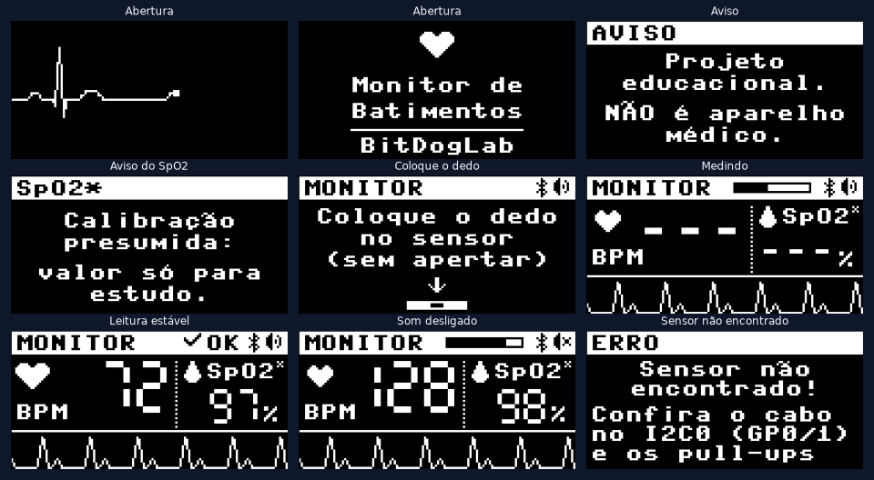
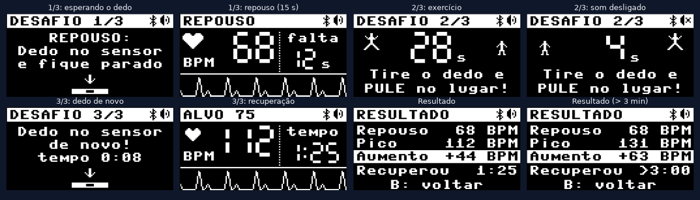
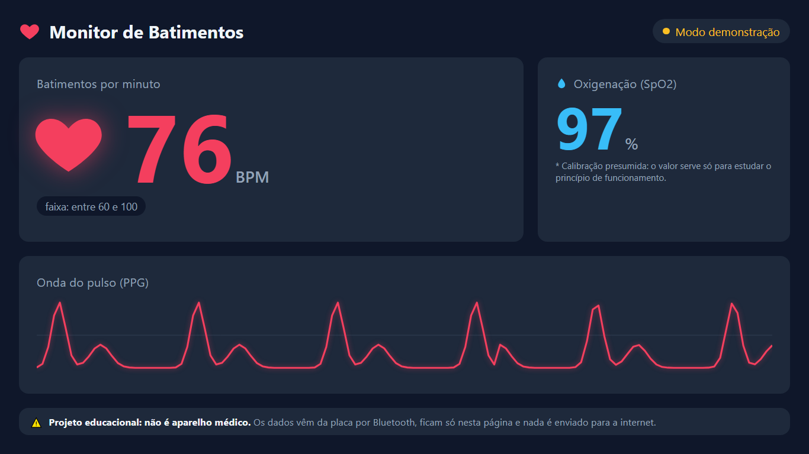

# Monitor de Batimentos

Medidor de frequência cardíaca (BPM) e oxigenação aproximada do sangue (SpO2)
feito com a placa **BitDogLab** e o sensor óptico **MAX30102**, programado em
**MicroPython**. Tem telas de monitor cardíaco no OLED, um coração que pulsa na
matriz de LEDs, bipe a cada batida, o **Desafio do Pátio** (repouso × depois de
pular) e um **painel por Bluetooth** para mostrar tudo no telão.

> ## ⚠️ Projeto educacional: NÃO é aparelho médico
> Os valores servem para **estudar** como funciona um oxímetro de pulso. Eles
> não são precisos o bastante para nenhuma decisão de saúde. Em especial, o
> **SpO2 usa uma calibração presumida** (veja [Calibração do SpO2](#calibração-do-spo2)).
> Se alguém se sentir mal durante o desafio, pare e procure um adulto responsável.



---

## Sumário

1. [O que ele faz](#o-que-ele-faz)
2. [Material](#material)
3. [Pinagem e ligação](#pinagem-e-ligação)
4. [Instalação passo a passo](#instalação-passo-a-passo)
5. [Como usar](#como-usar)
6. [Painel por Bluetooth (telão)](#painel-por-bluetooth-telão)
7. [Como funciona por dentro](#como-funciona-por-dentro)
8. [Calibração](#calibração)
9. [Problemas comuns](#problemas-comuns)
10. [Estrutura do projeto](#estrutura-do-projeto)
11. [Privacidade](#privacidade)
12. [Créditos](#créditos)

---

## O que ele faz

| Parte | O que mostra |
|---|---|
| **OLED 128×64** | Abertura animada com o aviso, "Coloque o dedo", barra de "Medindo", BPM em dígitos grandes, SpO2, coração que pulsa e a onda do pulso rolando |
| **Matriz 5×5** | Coração vermelho que acende a cada batida (brilho máximo baixo, < 10%) |
| **LED RGB** | Faixa do BPM: azul (< 60), verde (60–100), laranja (100–140), vermelho (> 140). É só uma faixa de valores, **sem interpretação médica** |
| **Buzzer** | Bipe curto a cada batida, como num monitor de hospital |
| **Botão A** | Liga e desliga o som |
| **Botão B** | Desafio do Pátio |
| **Bluetooth** | Envia as leituras para a página `web/index.html`, aberta no computador ligado ao telão |

---

## Material

- Placa **BitDogLab** com **Raspberry Pi Pico W (RP2040)**
- Sensor **MAX30102** (oxímetro e batimentos)
- Cabo de 4 vias para o conector I2C da BitDogLab
- Cabo USB e um computador com **VS Code**
- Para o painel: computador com **Chrome ou Edge** e Bluetooth

> **Sobre o sensor:** o kit usado no desenvolvimento (Embarcatech) traz uma
> plaquinha roxa escrita **GY-MAX30100**, mas o chip soldado nela é um
> **MAX30102**. O programa confere isso: o registrador `PART_ID` (0xFF) deve
> valer **0x15** (MAX30102). Um MAX30100 de verdade responderia 0x11 e tem
> outro mapa de registradores, por isso não é suportado.

---

## Pinagem e ligação

Pinagem da BitDogLab usada pelo projeto (confira na documentação da sua versão
da placa; todos os pinos podem ser mudados no `config.py`):

| Componente | Pino(s) | Observação |
|---|---|---|
| Sensor MAX30102 | **I2C0**: SDA = GP0, SCL = GP1 | Conector I2C externo, 400 kHz, endereço 0x57 |
| OLED SSD1306 128×64 | **I2C1**: SDA = GP14, SCL = GP15 | Endereço 0x3C |
| Matriz 5×5 WS2812 | GP7 | Ligada em zigue-zague |
| LED RGB | R = GP13, G = GP11, B = GP12 | PWM |
| Buzzer | GP21 | PWM |
| Botão A | GP5 | Som liga/desliga |
| Botão B | GP6 | Desafio do Pátio |

**Ligação do sensor** (cabo no conector I2C0 da BitDogLab):

| Sensor | BitDogLab |
|---|---|
| VIN | 3,3 V |
| GND | GND |
| SDA | SDA (GP0) |
| SCL | SCL (GP1) |
| INT | não usado |

---

## Instalação passo a passo

### 1. Gravar o firmware MicroPython

A BitDogLab usada aqui tem uma **Pico W com RP2040**, então o firmware é o
**RPI_PICO_W**. Se a sua tiver uma Pico 2 W (RP2350), use o **RPI_PICO2_W**.

1. Baixe o arquivo `.uf2` mais recente em
   <https://micropython.org/download/RPI_PICO_W/> (ou
   <https://micropython.org/download/RPI_PICO2_W/>).
2. Segure o botão **BOOTSEL** da Pico e conecte o cabo USB. Solte o botão.
3. Aparece um "pendrive" chamado `RPI-RP2`. Arraste o `.uf2` para ele.
4. A placa reinicia sozinha já com o MicroPython.

> Não sabe qual é a sua placa? Com o MicroPython já instalado, rode no REPL:
> `import os; os.uname().machine` → aparece algo como
> `Raspberry Pi Pico W with RP2040`.

### 2. Preparar o VS Code

1. Instale a extensão **MicroPico** (autor: paulober).
2. Abra a **pasta `monitor-batimentos`** no VS Code (Arquivo → Abrir Pasta).
3. Rode o comando **MicroPico: Configure Project** (Ctrl+Shift+P). Ele instala as
   definições do MicroPython, e os falsos erros como "ticks_ms não é um atributo
   conhecido" somem.
4. Conecte a placa: na barra de status aparece **Pico Connected**.

### 3. Criar o `config.py`

Copie o `config.py.example` para **`config.py`** (na mesma pasta). O `config.py`
fica **fora do Git** (veja `.gitignore`), porque cada placa tem os seus ajustes.
Os valores padrão já funcionam; a seção [Calibração](#calibração) explica o que
ajustar.

### 4. Enviar o projeto para a placa

Rode **MicroPico: Upload project to Pico**. Vão para a placa: `main.py`,
`config.py`, `cores.py`, a pasta `lib/` e a pasta `testes/`. A pasta `web/` e a
pasta `docs/` **não** vão: a página do painel abre direto no computador.

Depois, **desconecte o MicroPico** (clique em "Pico Connected") e reinicie a placa
(aperte o botão de reset ou tire e recoloque o USB). O `main.py` roda sozinho ao
ligar.

> Quando o MicroPico conecta, ele **interrompe** o `main.py`, o que é normal.
> Para ver o monitor funcionando, desconecte o MicroPico e reinicie a placa.

---

## Como usar

### Medindo

1. Ligue a placa: aparece a abertura com o aviso de projeto educacional.
2. A tela pede **"Coloque o dedo no sensor (sem apertar)"**.
3. Apoie a **ponta do dedo indicador** sobre o sensor:
   - **só encostado**, com o peso do dedo, **sem apertar**: apertar esmaga os
     vasinhos e o pulso **some** (foi medido: com o dedo pressionado, nenhuma
     batida foi detectada);
   - mão **apoiada na mesa** e **parada**, sem falar;
   - longe de **luz forte** direta (sol).
4. Barra **"Medindo"**: em ~1,5 s o sinal estabiliza e, depois de 5 batidas
   (~4 s), aparece o BPM. Quando os intervalos ficam regulares, aparece **✓ OK**.

Essa espera de 3 a 5 segundos é proposital: o BPM é a média dos últimos 4 a 8
intervalos entre batidas, e com menos que isso o valor sai pouco confiável.

### Desafio do Pátio (botão B)



| Fase | O que fazer |
|---|---|
| **1/3 Repouso** | Dedo no sensor e fique parado. Depois do primeiro BPM, conta **15 s** |
| **2/3 Exercício** | Tire o dedo e **pule no lugar** por **30 s** (bipes nos 3 últimos segundos). Apertar B termina antes |
| **3/3 Recuperação** | Coloque o dedo de novo. O aparelho guarda o **pico** do BPM e cronometra até ele voltar **perto do repouso** |
| **Resultado** | Repouso, pico, **aumento** e **tempo de recuperação**. Aperte B para voltar |

- "Perto do repouso" = até **repouso + 10%** (no mínimo + 5 BPM), confirmado em
  3 batidas seguidas.
- O tempo de recuperação conta **a partir do fim do exercício**.
- Se não voltar em 3 minutos, o resultado mostra "> 3:00".
- Apertar B em qualquer fase cancela o desafio.
- Os tempos podem ser mudados no `config.py` (`DESAFIO_REPOUSO_S`,
  `DESAFIO_EXERCICIO_S`).

---

## Painel por Bluetooth (telão)



A placa funciona como um aparelho **Bluetooth Low Energy (BLE)**, igual a uma
pulseira fitness, e aparece com o nome **`Batimentos-XXXX`** (o final muda de
placa para placa). Não usa Wi-Fi nem internet.

1. No computador ligado ao telão, abra o arquivo **`web/index.html`** no **Chrome
   ou Edge** (duplo clique no arquivo).
2. Clique em **Conectar à placa** e escolha **Batimentos-XXXX** na lista.
3. Pronto: BPM, SpO2, coração, onda e o Desafio aparecem na página. Se a conexão
   cair, a página tenta reconectar sozinha.

No OLED, o **ícone do Bluetooth** ao lado do ícone de som **pisca** enquanto
espera uma conexão e fica **aceso** quando a página está conectada.

- **Modo demonstração** (sem placa, para testar o telão ou mostrar aos alunos):
  abra `web/index.html?demo`.
- **App Android:** o mesmo painel também existe como app para celular, na pasta
  [`../app-monitor-batimentos`](../app-monitor-batimentos/) (Kotlin + Jetpack Compose).
  Ele usa o mesmo protocolo Bluetooth.
- Funciona no Chrome/Edge de **Windows, macOS, Linux e Android**. O **iPhone
  (iOS) não tem Web Bluetooth**.
- O alcance do BLE é de ~10 m.

**Formato dos dados** (para quem quiser estudar ou fazer outro programa): dois
canais ("características") no mesmo serviço, descritos em detalhe no topo de
[lib/painel_ble.py](lib/painel_ble.py):

| Característica | Conteúdo |
|---|---|
| **Estado** (16 bytes) | estado, flags, BPM, SpO2, progresso, contador de batidas, fase e valores do desafio |
| **Onda** (18 bytes) | 8 pontos da onda do pulso por pacote, ~3 pacotes por segundo |

Os dois cabem no tamanho padrão de uma notificação BLE (20 bytes).

---

## Como funciona por dentro

### Os arquivos

| Arquivo | Função |
|---|---|
| [main.py](main.py) | Laço principal com `asyncio`: várias tarefas revezando a CPU, sem `sleep` bloqueante |
| [lib/max30102.py](lib/max30102.py) | Driver do sensor, escrito do zero: configuração, leitura da FIFO, temperatura |
| [lib/sinal.py](lib/sinal.py) | Filtros, detecção do dedo, detecção de batimentos, BPM e SpO2 |
| [lib/display.py](lib/display.py) | Telas do OLED, dígitos grandes, ícones, acentos, onda |
| [lib/matriz.py](lib/matriz.py) | Matriz 5×5 (zigue-zague) e LED RGB |
| [lib/som.py](lib/som.py) | Buzzer não bloqueante |
| [lib/desafio.py](lib/desafio.py) | Lógica do Desafio do Pátio (não depende do hardware) |
| [lib/painel_ble.py](lib/painel_ble.py) | Envio por Bluetooth |
| [lib/ssd1306.py](lib/ssd1306.py) | Driver oficial do OLED (micropython-lib) |
| [cores.py](cores.py) | Todas as cores da matriz e do LED RGB num só lugar |
| [web/index.html](web/index.html) | Painel do telão (abre no computador) |

### As tarefas do programa

```
tarefa_sensor  (a cada 10 ms)   lê a FIFO e processa cada amostra; a cada batida: bipe + coração
tarefa_tela    (a cada 100 ms)  desenha o OLED (no máximo 10 quadros por segundo)
tarefa_luzes   (a cada 30 ms)   anima a matriz e o LED RGB
tarefa_botoes  (a cada 20 ms)   botões A e B
tarefa_ble     (a cada 50 ms)   envia as leituras ao painel
```

O sensor mede **104 vezes por segundo** e guarda até 32 medidas na sua fila
interna (FIFO), ou seja, 320 ms. Enquanto a tela é enviada ao OLED (~33 ms),
a fila segura as amostras: **nenhuma se perde** (medido: 0 perdidas).

### Do sinal cru ao BPM

```
luz que volta do dedo ──> [mediana] ──> [passa-alta] ──> [passa-baixa] ──> onda do pulso
   ~150.000 ± 300          tira picos     tira o nível     tira o ruído
                           isolados       fixo (DC)        (8–17 Hz)
```

1. **O sensor**: dois LEDs (vermelho e infravermelho) iluminam o dedo e um
   fotodiodo mede a luz que volta. Cada batida empurra mais sangue para o dedo,
   que absorve mais luz: o sinal oscila um pouquinho (~0,2% a 1% do total).
2. **Mediana de 3**: remove leituras isoladas absurdas (o sensor entrega uma a
   cada ~40 s).
3. **Passa-alta** (`y = α·(y_ant + x − x_ant)`, α = 0,95): remove o nível fixo
   (DC) e deixa só a oscilação do pulso (AC).
4. **Passa-baixa Butterworth de 2ª ordem** (4 Hz): remove o ruído. Nos dados
   gravados havia ruído entre 8 e 17 Hz (provavelmente o "pisca" das lâmpadas);
   com 2ª ordem a relação pulso/ruído ficou **3,5 vezes melhor** que com 1ª ordem.
5. **Detecção de batimentos**:
   - **limiar adaptativo**: só conta picos acima de 40% da altura típica dos
     últimos picos;
   - **pico** = o sinal estava subindo e começou a descer;
   - depois de uma batida, espera a onda **voltar abaixo de zero** e respeita um
     **período refratário** de 300 ms, ou 60% do intervalo médio se for maior.
     Isso ignora a "segunda corcova" (nó dicrótico) de cada batida, que nos
     dados reais **dobrava o BPM**.
6. **BPM** = 60 × taxa ÷ média dos últimos 8 intervalos. Intervalos 35% fora da
   média são descartados. A leitura é "estável" quando o maior e o menor
   intervalo diferem menos de 20%.

### SpO2: a razão das razões

O sangue **com** oxigênio e **sem** oxigênio absorvem as duas cores de luz de
jeitos diferentes. Batida a batida:

```
R = (AC_vermelho / DC_vermelho) / (AC_infravermelho / DC_infravermelho)
SpO2 ≈ A − B × R
```

O R é medido do mesmo jeito que no código de referência da **Maxim Integrated**,
fabricante do sensor (projeto MAXREFDES117, também usado na biblioteca da
SparkFun), e o resultado é a mediana dos R das últimas 5 batidas.

---

## Calibração

Todos os ajustes ficam no **`config.py`**.

### Limiar do dedo

O programa considera que há um dedo quando o nível do infravermelho passa de
`LIMIAR_DEDO` (padrão 30.000), e que o dedo saiu quando cai abaixo de
`LIMIAR_DEDO_SAIDA` (20.000). Os dois valores diferentes evitam que a tela fique
piscando perto do limite.

Medido neste projeto: **sem dedo ≈ 1.600 a 2.300**; **com dedo ≈ 84.000 a
157.000**. Para medir na sua placa, rode `testes/etapa1_fifo.py` sem o dedo e
depois com o dedo, e coloque o limiar bem no meio.

### Corrente dos LEDs

`LED_VERMELHO` e `LED_IR`: 0,2 mA por passo (0x00 a 0xFF). O padrão **0x24
(7,2 mA)** foi o melhor ponto:

- se aparecer **"SATURADO"** no `testes/etapa1_fifo.py` (valores perto de
  262.143), **diminua** (ex.: 0x1A);
- se a onda ficar muito pequena, **aumente** (ex.: 0x30);
- testado: com 0x40 (12,8 mA) o sensor saturou com um dedo e o pulso ficou mais
  fraco com outro.

### Calibração do SpO2

A fórmula do SpO2 é **empírica**: cada modelo de sensor precisa da sua própria
calibração. Com as curvas publicadas, **este** módulo dá valores irreais (~75%
com a fórmula clássica 110 − 25R, ~55% com a curva da Maxim), porque o R dele em
repouso é **~1,3**, mais alto que o dos sensores originais. Foi confirmado que a
luz ambiente **não** é a causa (com os LEDs apagados o sensor lê ~43 de ~100.000).

Por isso o projeto usa uma **calibração presumida de 1 ponto**:

```python
SPO2_REFERENCIA = 97.0      # SUPOMOS 97% para uma pessoa saudável em repouso
R_REPOUSO = 1.30            # R medido em repouso neste módulo (3 sessões)
SPO2_A = SPO2_REFERENCIA + SPO2_B * R_REPOUSO   # = 129,5
```

Isso é uma **suposição, não uma medida**: o aparelho mostra ~97% em repouso
porque foi ajustado para isso, e só as **variações** em relação ao repouso trazem
informação. Por isso o SpO2 aparece com um **\*** no OLED e no painel.

**Para fazer uma calibração de verdade**, use um oxímetro de dedo de farmácia (ou
um smartwatch que meça SpO2) na mesma pessoa, ao mesmo tempo:

1. Rode `testes/etapa4_spo2.py` e anote o **R** mostrado em repouso.
2. Anote o valor do oxímetro de referência.
3. No `config.py`: `SPO2_REFERENCIA` = valor do oxímetro, `R_REPOUSO` = R anotado
   e `SPO2_PRESUMIDO = False`.

O `testes/experimento_spo2.py` mede o R em condições diferentes (dedo leve,
pressionado, LEDs mais fortes) e a luz ambiente: bom para uma aula sobre o tema.

---

## Problemas comuns

### "Sensor não encontrado" no OLED (com um X vermelho na matriz)

- Confira se o cabo está no conector **I2C0** (GP0/GP1) e se **SDA e SCL** não
  estão trocados.
- Confira VIN (3,3 V) e GND.
- Rode `testes/etapa1_fifo.py`: ele faz o scan do I2C e mostra o `PART_ID`.
- O programa tenta de novo a cada 2 s: dá para conectar o sensor com a placa
  ligada.

### Leituras zeradas, instáveis ou erros de I2C

Alguns módulos roxos (**GY-MAX30100**) vêm com os **resistores de pull-up do I2C
ligados em 1,8 V** (a tensão do regulador da plaquinha). Com o RP2040 a 3,3 V,
isso pode dar leituras zeradas, instáveis ou falhas de comunicação. Correções:

- ligar os pull-ups em **3,3 V** (há módulos com uma ponte de solda para isso), ou
- **remover** os resistores de pull-up da plaquinha (o conjunto de 4,7 kΩ) e usar
  pull-ups externos de 4,7 kΩ para 3,3 V.

### BPM saltando ou demorando para estabilizar

- **Dedo mexendo** é a causa mais comum: apoie a mão na mesa e fique parado.
- **Dedo apertando** o sensor: o pulso diminui ou some. Só encoste.
- **Luz forte** direta no sensor (sol do pátio): faça sombra com a outra mão.
- Dedo frio tem pulso fraco: esfregue as mãos antes.
- A barra de carregamento enche até juntar 8 intervalos; o "✓ OK" só aparece
  quando os intervalos ficam parecidos entre si.

### SpO2 baixo ou mudando muito

Veja [Calibração do SpO2](#calibração-do-spo2). Dedo pressionado ou mal
posicionado aumenta o R, e o SpO2 "cai": isso pode até virar uma demonstração
didática.

### O painel não acha a placa

- Use **Chrome ou Edge** (Firefox e Safari não têm Web Bluetooth) com o
  Bluetooth do computador ligado.
- **Só uma conexão por vez**: enquanto uma página (ou outro aparelho) está
  conectada, a placa **para de se anunciar** e não aparece para mais ninguém.
  Feche a outra aba ou clique em "Desconectar" nela.
- Confira se `BLE_ATIVO = True` no `config.py` e se o ícone do Bluetooth aparece
  no OLED.

### O programa não começa sozinho

Se o MicroPico estiver conectado, ele interrompe o `main.py`. Desconecte o
MicroPico e reinicie a placa.

---

## Estrutura do projeto

```
monitor-batimentos/
├─ main.py              laço principal (asyncio)
├─ config.py.example    modelo de configuração (copie para config.py)
├─ config.py            seus ajustes (fora do Git)
├─ cores.py             cores da matriz e do LED RGB
├─ lib/
│  ├─ max30102.py       driver do sensor
│  ├─ sinal.py          filtros, batimentos e SpO2
│  ├─ display.py        telas do OLED
│  ├─ ssd1306.py        driver oficial do OLED
│  ├─ matriz.py         matriz 5x5 e LED RGB
│  ├─ som.py            buzzer não bloqueante
│  ├─ desafio.py        Desafio do Pátio
│  └─ painel_ble.py     painel por Bluetooth
├─ web/index.html       painel do telão (abre no computador)
├─ testes/              um teste por etapa do desenvolvimento
├─ docs/                imagens deste README
├─ .gitignore           (ignora o config.py)
└─ README.md
```

### Testes (pasta `testes/`)

Cada um roda sozinho no MicroPico (abra o arquivo e clique em **Run**):

| Teste | Para quê |
|---|---|
| `etapa1_fifo.py` | Scan do I2C, `PART_ID`, temperatura e leitura crua da FIFO (taxa, saturação, amostras perdidas) |
| `etapa2_sinal.py` | Detecção do dedo e filtros, com a onda desenhada **em texto no terminal** (ou no formato da extensão Teleplot) |
| `etapa3_bpm.py` | Uma linha por batida, com intervalo e BPM |
| `etapa4_spo2.py` | BPM, SpO2, R e índice de perfusão a cada batida |
| `etapa6_luzes.py` | Matriz (seta para conferir a orientação), LED RGB, buzzer e botão A |
| `ver_leds.py` | Acende o LED vermelho e o infravermelho, um de cada vez |
| `experimento_spo2.py` | Experimento guiado sobre o que muda o R do SpO2 |

### Desempenho medido na placa

| Item | Valor |
|---|---|
| Taxa de amostragem real | 104 amostras/s (o relógio do MAX30102 é ~4% rápido; o BPM usa a taxa real) |
| Amostras perdidas com tudo rodando | 0 |
| Processamento do sinal | ~10% da CPU |
| Desenhar a tela principal | ~7 ms (+ ~26 ms para enviar ao OLED a 400 kHz) |
| RAM livre | ~180 KB |

---

## Privacidade

- O aparelho **não pede nem guarda** nome ou qualquer identificação de quem mede.
- Os valores ficam **só na memória** e somem ao reiniciar ou começar outro
  desafio. Nada é gravado na placa.
- Nada vai para a internet: a placa não usa Wi-Fi e a página do painel não
  carrega nada de fora (nem fontes).
- O Bluetooth alcança ~10 m e as notificações **não são criptografadas**:
  qualquer aparelho próximo que conheça o formato poderia ler os números. Por
  isso **nenhum dado pessoal** é enviado, só BPM, SpO2 e a onda.

---

## Créditos

- Driver do OLED: [micropython-lib/ssd1306](https://github.com/micropython/micropython-lib/tree/master/micropython/drivers/display/ssd1306) (licença MIT).
- Método da razão das razões e curva de calibração de referência: Maxim
  Integrated, projeto de referência MAXREFDES117.
- Detecção de batimentos, filtros, telas e Desafio do Pátio: escritos para este
  projeto, com comentários didáticos em português.
